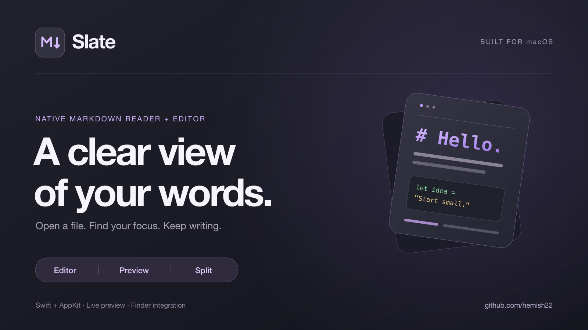

<p align="center">
  
</p>

# Slate

**A lightweight, native macOS Markdown reader and editor.**

Read a document, edit its source, or keep both side by side. Slate pairs a native AppKit editor with a live WebKit preview, wrapped in a charcoal theme with purple syntax colors.

[Installation](#installation) · [Features](#features) · [Screenshots](#screenshots) · [Shortcuts](#keyboard-shortcuts) · [Development](#development)

## Features

- **Three views:** editor, preview, and a resizable split view. Your selected view is remembered.
- **Live preview:** headings, tables, nested lists, task lists, links, images, blockquotes, fenced code, and strikethrough.
- **Native editing:** line numbers, syntax colors, find and replace, undo/redo, and Markdown formatting shortcuts.
- **Finder integration:** open `.md`, `.markdown`, `.mdown`, `.mkd`, and `.mkdn` files directly.
- **Document tools:** autosave for saved files, Save As, Revert to Saved, recent files, multiple windows, native window tabs, and fullscreen.
- **Reading and navigation:** heading outline, optional synchronized scrolling, zoom, word count, reading time, and cursor position.
- **Plain files:** UTF-8 and Unicode, preserving an existing BOM and LF, CRLF, or CR line endings.

No Electron, account, backend, or runtime package installation. The app uses Apple's system frameworks and a bundled Markdown parser.

## Requirements

| | Requirement |
| --- | --- |
| Run Slate | macOS 13 Ventura or later |
| Build from source | Xcode or Apple's Command Line Tools, including Swift and the macOS SDK |
| Run tests | The build tools above, plus Node.js 18 or later |
| Architecture | Apple Silicon or Intel; builds target your current Mac by default |

## Installation

### Build and install from source

Install Apple's development tools if they are not already installed:

```sh
xcode-select --install
```

Wait for the installation to finish, then clone and build:

```sh
git clone https://github.com/hemish22/Slate---Mac-Native-Lightweight-Markdown-Reader.git
cd Slate---Mac-Native-Lightweight-Markdown-Reader
make build
open build/Slate.app
```

To install for your user account, quit any running copy of Slate and run:

```sh
make install
```

This installs to `~/Applications/Slate.app`. To install to `/Applications` instead, use a directory you have permission to write:

```sh
SLATE_INSTALL_DIR=/Applications make install
```

To uninstall, quit Slate and delete `Slate.app` from the folder you installed it to (`~/Applications` by default). Slate stores only its preferences, in `~/Library/Preferences/com.hemish.slate.plist`.

No dependency downloads are needed to build the app. Node.js is only needed for the renderer tests.

### Prebuilt downloads

If a packaged version is available, download `Slate.zip` from [GitHub Releases](https://github.com/hemish22/Slate---Mac-Native-Lightweight-Markdown-Reader/releases), unzip it, and drag `Slate.app` to Applications. Source builds remain available using the commands above.

Local builds and automated release archives use an ad hoc signature. They are not Developer ID signed or notarized. If macOS blocks a downloaded copy, inspect its source and provenance, then use **System Settings → Privacy & Security → Open Anyway** if you choose to allow it. Building locally avoids relying on a downloaded executable. Do not disable Gatekeeper globally.

### Open Markdown files from Finder

Right-click a Markdown file and choose **Open With → Slate**. If Slate is not listed, choose **Other…** and select the installed app.

To make Slate the default, select a `.md` file, press **⌘I**, select Slate under **Open with**, and choose **Change All…**. Other file extensions can be configured separately.

## Screenshots

<!-- SCREENSHOTS:START -->

### Split view


### Editor


### Preview


<!-- SCREENSHOTS:END -->

## Keyboard shortcuts

| Action | Shortcut |
| --- | --- |
| New document | ⌘N |
| Open / Save | ⌘O / ⌘S |
| Save As | ⇧⌘S |
| Editor / Preview / Split | ⌘1 / ⌘2 / ⌘3 |
| Find and replace | ⌘F |
| Bold / Italic | ⌘B / ⌘I |
| Inline code / Link | ⌘E / ⌘K |
| Undo / Redo | ⌘Z / ⇧⌘Z |
| Zoom in / out / reset | ⌘+ / ⌘− / ⌘0 |
| Close window | ⌘W |
| Fullscreen | ⌃⌘F |

Use the toolbar's outline button to jump to headings. Drag the split divider to change the pane widths, or use the link button to toggle synchronized scrolling. **Help → Welcome to Slate** opens an editable guide.

## Development

```sh
make build        # Build build/Slate.app for this Mac
make run          # Build and launch
make test         # File handling, AppKit rendering, and Markdown tests
make package      # Build build/Slate.zip and build/SHA256SUMS
make screenshots  # Capture all three views on a macOS desktop
make clean        # Remove generated build files
```

To build a universal app for Apple Silicon and Intel:

```sh
SLATE_BUILD_ARCHS="arm64 x86_64" make package
```

The test command requires Node.js. If you already use Homebrew, you can install it with `brew install node`; otherwise use the installer from [nodejs.org](https://nodejs.org/).

### Project layout

```text
Sources/          Native AppKit app, document model, editor, and preview bridge
Resources/        Offline HTML/CSS preview, renderer, app icon, and bundle metadata
Resources/vendor/ markdown-it and its MIT license
Scripts/          Build, install, package, screenshot, and publishing tools
Tests/            File handling, editor rendering, split view, and renderer checks
Examples/         Demo document used for screenshots
docs/             Launch images, release notes, and social post copy
.github/workflows/ macOS validation and tagged release builds
```

### CI and releases

The CI workflow builds the app and runs the tests on macOS for pushes and pull requests. Tags matching `v*` run the release workflow, which tests the code, builds a universal app, and uploads `Slate.zip` and its SHA-256 checksum to a GitHub release.

From a normal authenticated checkout, a maintainer can publish a version (here `1.0.3`, after updating `Resources/Info.plist` and `CHANGELOG.md`) with:

```sh
git tag v1.0.3
git push origin v1.0.3
```

The tag should match the version in `Resources/Info.plist`. Tagged archives are ad hoc signed; automated releases do not perform Developer ID signing or notarization.

## Rendering and privacy

Markdown is parsed locally using [markdown-it](https://github.com/markdown-it/markdown-it), bundled under its MIT license. Reading, editing, and previewing local text work offline. Slate has no analytics or account system.

Remote images can still contact their original servers, and clicking a web link opens your default browser. Relative raster images and links to other Markdown documents resolve inside the open file's folder; parent-directory paths and local SVG images are not served.

Raw HTML is shown as text. Mermaid, math rendering, embedded HTML, and language-specific preview code coloring are not included. Preview code blocks use one code color, and task checkboxes are read-only; edit their Markdown source to change them. Synchronized scrolling follows each pane's relative position.

Files must use UTF-8. Syntax coloring is skipped above 500,000 UTF-16 code units to keep large documents responsive.

## Contributing

Bug reports and focused pull requests are welcome. See [CONTRIBUTING.md](CONTRIBUTING.md) for the setup and verification steps, and [CHANGELOG.md](CHANGELOG.md) for release history.

## License

[MIT](LICENSE) · Copyright © 2026 Hemish Jain. Third-party notices are in [Resources/vendor](Resources/vendor).
